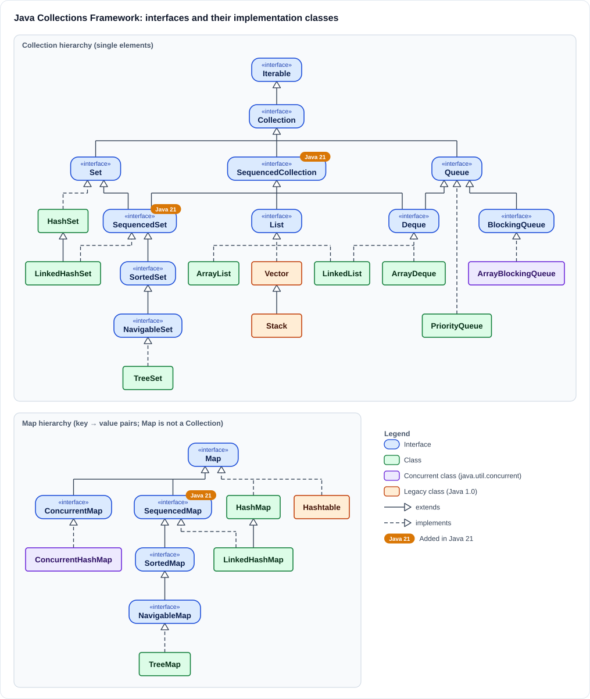

# Java Collections Framework - Complete Guide

## Table of Contents
- [Collections Framework Hierarchy](#collections-framework-hierarchy)
- [1. Set](#1-set)
  - [1.1 HashSet](#11-hashset)
    - [1.1.1 LinkedHashSet](#111-linkedhashset)
  - [1.2 SortedSet](#12-sortedset)
    - [1.2.1 NavigableSet](#121-navigableset)
      - [1.2.1.1 TreeSet](#1211-treeset)
      - [1.2.1.2 ConcurrentSkipListSet](#1212-concurrentskiplistset)
  - [1.3 EnumSet](#13-enumset)
  - [1.4 CopyOnWriteArraySet](#14-copyonwritearrayset)
  - [1.5 SequencedSet (Java 21)](#15-sequencedset-java-21)
  - [1.6 Thread-safe and Immutable Sets](#16-thread-safe-and-immutable-sets)
  - [1.7 Comparison of All Sets](#17-comparison-of-all-sets)

---

## Collections Framework Hierarchy

The **Java Collections Framework (JCF)** is a set of interfaces and classes in `java.util` (with thread-safe versions in `java.util.concurrent`) for storing and processing groups of objects. It has three parts:

| Part | What it is | Examples |
|------|------------|----------|
| **Interfaces** | Abstract data types: they define *what* operations a collection supports | `List`, `Set`, `Queue`, `Deque`, `Map` |
| **Implementations** | Concrete classes: they define *how* the data is stored | `ArrayList`, `HashSet`, `ArrayDeque`, `HashMap` |
| **Algorithms** | Static utility methods that work on any collection | `Collections.sort()`, `Collections.unmodifiableList()`, `Arrays.asList()` |

The framework has **two separate root hierarchies**:

1. **`Collection`** (extends `Iterable`): a group of individual elements. Its three main sub-interfaces are `List`, `Set`, and `Queue`.
2. **`Map`**: a group of key → value pairs. `Map` does **not** extend `Collection`.

### How to Read the Diagram

The diagram below uses standard UML arrows (it also has its own legend):

| Symbol | Meaning |
|--------|---------|
| Blue rounded box marked «interface» | Interface |
| Green box | Concrete class (`java.util`) |
| Purple box | Concurrent class (`java.util.concurrent`), thread-safe |
| Orange box | Legacy class (Java 1.0, synchronized), avoid in new code |
| Solid line ending in a hollow triangle | **extends**: interface extends interface, or class extends class |
| Dashed line ending in a hollow triangle | **implements**: class implements interface |
| Orange **Java 21** badge | Interface added in Java 21, the newest additions to the framework |

The hollow triangle always points to the parent type, and parents sit above their children. When several types share a parent, their lines join into one shared line before reaching it. A type with two parents, such as `Deque` (`Queue` and `SequencedCollection`), has a line to each.

### Complete Hierarchy Overview



**Key points from the diagram:**
- `List`, `Set`, and `Queue` are all `Collection`s, so every one of them supports `add()`, `remove()`, `contains()`, `size()`, `iterator()`, and `stream()`.
- The three interfaces marked **Java 21** (`SequencedCollection`, `SequencedSet`, `SequencedMap`) are the newest. They give every collection with a defined order the same `getFirst()`, `getLast()` and `reversed()` methods: `List` and `Deque` now extend `SequencedCollection`, `SortedSet` extends `SequencedSet`, and `SortedMap` extends `SequencedMap`.
- `LinkedList` is the only class here that sits in **two** branches: it is both a `List` and a `Deque`.
- `LinkedHashSet` and `LinkedHashMap` **extend** `HashSet` and `HashMap`, adding a linked list that remembers insertion order. Since Java 21 they also implement `SequencedSet` and `SequencedMap`.
- `TreeSet` and `TreeMap` implement the `Navigable*` interfaces, which is where methods like `floor()`, `ceiling()`, `headSet()`, and `headMap()` come from.
- `Map` stands on its own because each entry is a key **and** a value, but it can give you `Collection` views of its keys, values, and entries (`keySet()`, `values()`, `entrySet()`).

---

## 1. Set

`Set<E>` (`java.util`, Java 1.2) is a `Collection` that **never contains duplicate elements**, like a set in mathematics. It extends `Collection`, so it has the usual `add`, `remove`, `contains`, `size` and iteration methods, but it has **no index**: there is no `get(i)`. What makes a collection a `Set` is its contract: adding an element that is already present does nothing.

The examples in this section need Java 17 or newer (newer APIs are marked), and every output shown was produced by running the example on Java 21.

**Characteristics shared by all sets:**
- **No duplicates:** `add()` returns `false` and leaves the set unchanged when the element is already present.
- **How "duplicate" is decided:** hash-based sets use `hashCode()` and `equals()`; sorted sets use `compareTo()` or the set's `Comparator`.
- **`null`:** at most one `null`, and only in implementations that allow `null` at all.
- **No positional access:** no `get(int)`, `set(int, e)` or `indexOf()`.
- **Order depends on the implementation:** none (`HashSet`), insertion order (`LinkedHashSet`), sorted (`TreeSet`), or enum declaration order (`EnumSet`).
- **Do not mutate elements** in a way that changes their `equals()`/`hashCode()` (or their sort position) while they are in a set; the set will no longer find them.

**Set types at a glance:**

| # | Type | Kind | Ordering | `null` | Thread-safe | Since |
|---|------|------|----------|--------|-------------|-------|
| [1.1](#11-hashset) | `HashSet` | Class | None | One | No | 1.2 |
| [1.1.1](#111-linkedhashset) | `LinkedHashSet` | Class | Insertion order | One | No | 1.4 |
| [1.2](#12-sortedset) | `SortedSet` | Interface | Sorted | Depends on the implementation | Depends | 1.2 |
| [1.2.1](#121-navigableset) | `NavigableSet` | Interface | Sorted | Depends on the implementation | Depends | 6 |
| [1.2.1.1](#1211-treeset) | `TreeSet` | Class | Sorted | No (natural ordering) | No | 1.2 |
| [1.2.1.2](#1212-concurrentskiplistset) | `ConcurrentSkipListSet` | Class | Sorted | No | Yes | 6 |
| [1.3](#13-enumset) | `EnumSet` | Abstract class | Enum declaration order | No | No | 5 |
| [1.4](#14-copyonwritearrayset) | `CopyOnWriteArraySet` | Class | Insertion order | One | Yes | 5 |
| [1.5](#15-sequencedset-java-21) | `SequencedSet` | Interface | Defined encounter order | Depends on the implementation | Depends | 21 |

**Common `Set` methods:**

| Method | What it does |
|--------|--------------|
| `add(e)` | Adds `e` if it is not already present; returns `true` if the set changed |
| `remove(o)` | Removes `o`; returns `true` if it was present |
| `contains(o)` | Returns `true` if the set contains `o` |
| `size()`, `isEmpty()`, `clear()` | Number of elements, emptiness check, remove everything |
| `addAll(c)` | **Union**: adds every element of `c` |
| `retainAll(c)` | **Intersection**: keeps only the elements that are also in `c` |
| `removeAll(c)` | **Difference**: removes every element of `c` |
| `containsAll(c)` | **Subset** check: `true` if every element of `c` is in the set |
| `removeIf(predicate)` | Removes every element that matches (Java 8) |
| `iterator()`, `forEach(action)`, `stream()` | Iterate over the elements |
| `Set.of(...)`, `Set.copyOf(c)` | Create an immutable set (Java 9 / 10), see [1.6](#16-thread-safe-and-immutable-sets) |

```java
Set<String> languages = new HashSet<>();
languages.add("Java");
languages.add("Kotlin");
System.out.println(languages.add("Java"));          // false: already present
System.out.println(languages.contains("Kotlin"));
System.out.println(languages.size());
languages.remove("Kotlin");
System.out.println(languages);

Set<Integer> a = new TreeSet<>(List.of(1, 2, 3, 4));
Set<Integer> b = new TreeSet<>(List.of(3, 4, 5));
Set<Integer> union = new TreeSet<>(a);
union.addAll(b);
Set<Integer> intersection = new TreeSet<>(a);
intersection.retainAll(b);
Set<Integer> difference = new TreeSet<>(a);
difference.removeAll(b);
System.out.println("union=" + union + " intersection=" + intersection + " difference=" + difference);
System.out.println(a.containsAll(Set.of(1, 2)));     // is {1, 2} a subset of a?
```

**Output:**

```text
false
true
2
[Java]
union=[1, 2, 3, 4, 5] intersection=[3, 4] difference=[1, 2]
true
```

`addAll`, `retainAll` and `removeAll` change the set they are called on, which is why the example copies `a` first.

### 1.1 HashSet

**Characteristics:**

| Characteristic | `HashSet` |
|----------------|-----------|
| Kind | Class in `java.util`, since Java 1.2 |
| Hierarchy | Extends `AbstractSet`; implements `Set`, `Cloneable`, `Serializable` |
| Ordering | **No order.** Elements come out in hash-bucket order, which can change when the set grows |
| `null` | **One** `null` element allowed |
| Duplicates | Not allowed; decided by `hashCode()` and `equals()` |
| Thread-safe | **No.** For shared use, see [1.6](#16-thread-safe-and-immutable-sets) |
| Internal structure | A `HashMap`: each element is stored as a key, mapped to one shared dummy value |
| Performance | `add`, `remove`, `contains` O(1) on average; iteration O(capacity + size) |
| Defaults | Initial capacity 16, load factor 0.75 |
| Iterator | Fail-fast: throws `ConcurrentModificationException` if the set is modified during iteration |
| Use it for | The default `Set`: removing duplicates, fast "have I seen this?" checks, set operations |

**Constructors:**

```java
Set<String> a = new HashSet<>();                    // capacity 16, load factor 0.75
Set<String> b = new HashSet<>(100);                 // initial capacity
Set<String> c = new HashSet<>(100, 0.5f);           // initial capacity and load factor
Set<String> d = new HashSet<>(List.of("x", "y"));   // copy of another collection
Set<String> e = HashSet.newHashSet(100);            // Java 19+: room for 100 elements without resizing
```

**Example 1: duplicates, `null` and ordering**

```java
Set<String> fruits = new HashSet<>();
fruits.add("banana");
fruits.add("apple");
fruits.add("cherry");
System.out.println(fruits.add("apple"));    // duplicate: not added
System.out.println(fruits.add(null));       // one null is allowed
System.out.println(fruits.add(null));       // a second null is a duplicate
System.out.println(fruits);                 // not in insertion order
System.out.println(fruits.contains("cherry") + " " + fruits.size());
```

**Output:**

```text
false
true
false
[banana, null, apple, cherry]
true 4
```

The order comes from the elements' hash codes, not from the order they were added. It is not random, but never rely on it.

**Example 2: finding duplicates with the return value of `add()`**

```java
List<String> words = List.of("to", "be", "or", "not", "to", "be");

Set<String> unique = new HashSet<>(words);
System.out.println(unique.size());             // number of distinct words

Set<String> seen = new HashSet<>();
List<String> repeated = new ArrayList<>();
for (String word : words) {
    if (!seen.add(word)) {                     // add() returns false for a word seen before
        repeated.add(word);
    }
}
System.out.println(repeated);
```

**Output:**

```text
4
[to, be]
```

**Example 3: custom elements must override `equals()` and `hashCode()`**

A `HashSet` finds the bucket with `hashCode()` and then compares with `equals()`. If a class overrides only `equals()`, two equal objects get different identity hash codes, land in different buckets, and both are kept.

```java
class PointEqualsOnly {
    final int x, y;
    PointEqualsOnly(int x, int y) { this.x = x; this.y = y; }

    @Override
    public boolean equals(Object o) {
        return o instanceof PointEqualsOnly p && p.x == x && p.y == y;
    }
    // hashCode() is NOT overridden
}

record Point(int x, int y) { }   // records generate equals() and hashCode()

Set<PointEqualsOnly> broken = new HashSet<>();
broken.add(new PointEqualsOnly(1, 2));
broken.add(new PointEqualsOnly(1, 2));
System.out.println("equals only:       size=" + broken.size()
        + ", contains=" + broken.contains(new PointEqualsOnly(1, 2)));

Set<Point> correct = new HashSet<>();
correct.add(new Point(1, 2));
correct.add(new Point(1, 2));
System.out.println("equals + hashCode: size=" + correct.size()
        + ", contains=" + correct.contains(new Point(1, 2)));
```

**Output:**

```text
equals only:       size=2, contains=false
equals + hashCode: size=1, contains=true
```

**Example 4: `HashSet` is not thread-safe**

When several threads add to a plain `HashSet` at the same time, elements can be lost and the internal table can be corrupted. Use a concurrent set instead:

```java
Set<Integer> shared = ConcurrentHashMap.newKeySet();   // thread-safe alternative to HashSet
ExecutorService pool = Executors.newFixedThreadPool(4);
for (int t = 0; t < 4; t++) {
    int start = t * 1_000;
    pool.submit(() -> {
        for (int i = start; i < start + 1_000; i++) {
            shared.add(i);
        }
    });
}
pool.shutdown();
pool.awaitTermination(10, TimeUnit.SECONDS);
System.out.println(shared.size());

Set<String> synced = Collections.synchronizedSet(new HashSet<>(Set.of("a")));
synchronized (synced) {             // a synchronized set must be locked while you iterate
    for (String s : synced) {
        System.out.println(s);
    }
}
```

**Output:**

```text
4000
a
```

#### 1.1.1 LinkedHashSet

**Characteristics:**

| Characteristic | `LinkedHashSet` |
|----------------|-----------------|
| Kind | Class in `java.util`, since Java 1.4 |
| Hierarchy | Extends `HashSet`; implements `Set`, `SequencedSet` (Java 21), `Cloneable`, `Serializable` |
| Ordering | **Insertion order.** Re-adding an element that is already present does not move it |
| `null` | **One** `null` element allowed |
| Duplicates | Not allowed; decided by `hashCode()` and `equals()` |
| Thread-safe | **No.** Wrap it with `Collections.synchronizedSet(...)` for shared use |
| Internal structure | A `LinkedHashMap`: a hash table plus a doubly-linked list that runs through the elements in insertion order |
| Performance | `add`, `remove`, `contains` O(1); iteration O(size); a little more memory than `HashSet` |
| Iterator | Fail-fast, in insertion order |
| Use it for | Removing duplicates while keeping the original order; ordered unique lists such as tags, menu items or recently used entries |

**Example 1: insertion order**

```java
Set<String> tags = new LinkedHashSet<>();
tags.add("java");
tags.add("spring");
tags.add("docker");
tags.add("java");                 // already present: keeps its first position
System.out.println(tags);

tags.remove("java");              // to move an element to the end, remove it and add it again
tags.add("java");
System.out.println(tags);

tags.add(null);                   // one null is allowed
System.out.println(tags);
```

**Output:**

```text
[java, spring, docker]
[spring, docker, java]
[spring, docker, java, null]
```

**Example 2: removing duplicates from a list without losing the order**

```java
List<String> input = List.of("banana", "apple", "cherry", "apple", "date");

System.out.println(new ArrayList<>(new LinkedHashSet<>(input)));  // first occurrence of each, in order
System.out.println(new HashSet<>(input));                         // duplicates removed, order lost
```

**Output:**

```text
[banana, apple, cherry, date]
[banana, date, apple, cherry]
```

**Example 3: first, last and reversed (Java 21)**

Since Java 21, `LinkedHashSet` implements `SequencedSet` ([1.5](#15-sequencedset-java-21)). `addFirst()` and `addLast()` also **move** an element that is already present.

```java
LinkedHashSet<String> steps = new LinkedHashSet<>(List.of("build", "test", "deploy"));
System.out.println(steps.getFirst() + " " + steps.getLast());

steps.addFirst("checkout");       // new element at the front
steps.addFirst("test");           // existing element moved to the front
System.out.println(steps);
System.out.println(steps.reversed());
```

**Output:**

```text
build deploy
[test, checkout, build, deploy]
[deploy, build, checkout, test]
```

### 1.2 SortedSet

**Characteristics:**

| Characteristic | `SortedSet` |
|----------------|-------------|
| Kind | Interface in `java.util`, since Java 1.2 |
| Hierarchy | Extends `Set` (and, since Java 21, `SequencedSet`); extended by `NavigableSet` |
| Implementations | `TreeSet` and `ConcurrentSkipListSet` (both through `NavigableSet`) |
| Ordering | **Ascending sorted order**: the elements' natural ordering (`Comparable`), or the `Comparator` given when the set was created |
| `null` | Depends on the implementation and comparator; not allowed with natural ordering |
| Duplicates | Not allowed; two elements are duplicates when `compareTo()`/`compare()` returns `0` |
| Thread-safe | Depends on the implementation: `TreeSet` no, `ConcurrentSkipListSet` yes |
| Use it for | Declaring variables and parameters that need sorted elements, the lowest and highest element, and range views |

**Methods:**

| Method | Returns |
|--------|---------|
| `first()` / `last()` | The lowest / highest element (`NoSuchElementException` if the set is empty) |
| `headSet(to)` | A view of the elements **less than** `to` |
| `tailSet(from)` | A view of the elements **greater than or equal to** `from` |
| `subSet(from, to)` | A view of the elements **≥ `from` and < `to`** |
| `comparator()` | The comparator, or `null` when the set uses natural ordering |

**Example:**

```java
SortedSet<Integer> scores = new TreeSet<>(List.of(70, 85, 90, 55, 100));
System.out.println(scores);                     // always sorted
System.out.println(scores.first() + " " + scores.last());
System.out.println(scores.headSet(85));         // < 85
System.out.println(scores.tailSet(85));         // >= 85
System.out.println(scores.subSet(60, 95));      // >= 60 and < 95
System.out.println(scores.comparator());        // null: natural ordering

// Range views are live: they show later changes to the set
SortedSet<Integer> passing = scores.tailSet(60);
scores.add(65);
System.out.println(passing);
try {
    passing.add(10);                            // outside the view's range
} catch (IllegalArgumentException e) {
    System.out.println("passing.add(10) -> " + e.getClass().getSimpleName());
}
```

**Output:**

```text
[55, 70, 85, 90, 100]
55 100
[55, 70]
[85, 90, 100]
[70, 85, 90]
null
[65, 70, 85, 90, 100]
passing.add(10) -> IllegalArgumentException
```

#### 1.2.1 NavigableSet

**Characteristics:**

| Characteristic | `NavigableSet` |
|----------------|----------------|
| Kind | Interface in `java.util`, since Java 6 |
| Hierarchy | Extends `SortedSet` |
| Implementations | `TreeSet`, `ConcurrentSkipListSet` |
| Ordering | Sorted, like `SortedSet` |
| `null` | Depends on the implementation: not allowed in `ConcurrentSkipListSet`, or in `TreeSet` with natural ordering |
| Thread-safe | Depends on the implementation |
| Adds | Closest-match searches, removal of the lowest or highest element, descending views, and ranges with inclusive or exclusive bounds |
| Use it for | "Nearest value" questions: the next free slot, the closest price, the grade for a score |

**Methods:**

| Method | Returns (`null` if there is no such element) |
|--------|----------------------------------------------|
| `lower(e)` | The greatest element **< e** |
| `floor(e)` | The greatest element **≤ e** |
| `ceiling(e)` | The smallest element **≥ e** |
| `higher(e)` | The smallest element **> e** |
| `pollFirst()` / `pollLast()` | Removes and returns the lowest / highest element |
| `descendingSet()` / `descendingIterator()` | A reverse-order view / iterator |
| `headSet(to, inclusive)`, `tailSet(from, inclusive)`, `subSet(from, fromInclusive, to, toInclusive)` | Range views with explicit inclusive/exclusive bounds |

**Example:**

```java
NavigableSet<Integer> freeHours = new TreeSet<>(List.of(9, 10, 12, 14, 16));

System.out.println(freeHours.lower(12) + " " + freeHours.floor(12));      // < 12 and <= 12
System.out.println(freeHours.ceiling(13) + " " + freeHours.higher(14));   // >= 13 and > 14
System.out.println(freeHours.higher(16));                                  // nothing above 16
System.out.println(freeHours.descendingSet());
System.out.println(freeHours.subSet(10, true, 14, true));                  // 10 to 14, both included
System.out.println(freeHours.headSet(12, true));                           // up to 12, included

System.out.println(freeHours.pollFirst() + " " + freeHours.pollLast());    // removes the earliest and latest
System.out.println(freeHours);
```

**Output:**

```text
10 12
14 16
null
[16, 14, 12, 10, 9]
[10, 12, 14]
[9, 10, 12]
9 16
[10, 12, 14]
```

##### 1.2.1.1 TreeSet

**Characteristics:**

| Characteristic | `TreeSet` |
|----------------|-----------|
| Kind | Class in `java.util`, since Java 1.2 |
| Hierarchy | Extends `AbstractSet`; implements `NavigableSet` (so also `SortedSet` and, since Java 21, `SequencedSet`), `Cloneable`, `Serializable` |
| Ordering | **Sorted**: natural ordering, or the `Comparator` passed to the constructor |
| `null` | **Not allowed** with natural ordering (`NullPointerException`); allowed with a null-safe comparator such as `Comparator.nullsFirst(...)` |
| Duplicates | Not allowed; an element is a duplicate when `compareTo()`/`compare()` returns `0`, even if `equals()` says otherwise |
| Thread-safe | **No.** Use `ConcurrentSkipListSet` ([1.2.1.2](#1212-concurrentskiplistset)) or `Collections.synchronizedNavigableSet(...)` |
| Internal structure | A `TreeMap`, which is a red-black tree (a self-balancing binary search tree) |
| Performance | `add`, `remove`, `contains`, `first`, `last`, `floor`, `ceiling` O(log n); in-order iteration O(n) |
| Element requirement | Elements must implement `Comparable`, or you must pass a `Comparator`; otherwise `add()` throws `ClassCastException` |
| Iterator | Fail-fast, in sorted order |
| Use it for | Sorted unique data, leaderboards, range queries ("everything between A and B"), nearest-value lookups |

**Constructors:**

```java
TreeSet<String> natural = new TreeSet<>();                               // natural ordering
TreeSet<String> reversed = new TreeSet<>(Comparator.reverseOrder());    // with a Comparator
TreeSet<String> fromList = new TreeSet<>(List.of("b", "a"));             // copy, sorted naturally
TreeSet<String> sameOrder = new TreeSet<>(reversed);                     // copy of a SortedSet keeps its comparator
```

**Example 1: natural ordering and custom comparators**

```java
List<String> names = List.of("bob", "Alice", "dave", "Carol");

System.out.println(new TreeSet<>(names));                   // natural: uppercase letters sort first

Set<String> ignoreCase = new TreeSet<>(String.CASE_INSENSITIVE_ORDER);
ignoreCase.addAll(names);
System.out.println(ignoreCase);

Set<String> descending = new TreeSet<>(Comparator.reverseOrder());
descending.addAll(names);
System.out.println(descending);

Set<String> byLength = new TreeSet<>(Comparator.comparing(String::length)
        .thenComparing(Comparator.naturalOrder()));         // by length, then alphabetically
byLength.addAll(names);
System.out.println(byLength);
```

**Output:**

```text
[Alice, Carol, bob, dave]
[Alice, bob, Carol, dave]
[dave, bob, Carol, Alice]
[bob, dave, Alice, Carol]
```

**Example 2: `null` elements**

```java
TreeSet<String> natural = new TreeSet<>();
try {
    natural.add(null);
} catch (NullPointerException e) {
    System.out.println("natural.add(null) -> " + e.getClass().getSimpleName());
}

TreeSet<String> nullsFirst = new TreeSet<>(Comparator.nullsFirst(Comparator.naturalOrder()));
nullsFirst.addAll(Arrays.asList("pear", null, "apple"));
System.out.println(nullsFirst);
```

**Output:**

```text
natural.add(null) -> NullPointerException
[null, apple, pear]
```

**Example 3: the comparator decides what counts as a duplicate**

```java
// Comparing only by length: words with the same length count as duplicates
Set<String> byLengthOnly = new TreeSet<>(Comparator.comparing(String::length));
byLengthOnly.addAll(List.of("apple", "mango", "fig", "kiwi"));
System.out.println(byLengthOnly);                          // "mango" was silently dropped

BigDecimal a = new BigDecimal("1.0");
BigDecimal b = new BigDecimal("1.00");                     // equals() is false, compareTo() is 0
System.out.println("HashSet size=" + new HashSet<>(List.of(a, b)).size()
        + ", TreeSet size=" + new TreeSet<>(List.of(a, b)).size());
```

**Output:**

```text
[fig, kiwi, apple]
HashSet size=2, TreeSet size=1
```

Make the comparator break every tie (as `thenComparing(...)` does in Example 1) unless you really want "same position" to mean "same element".

**Example 4: elements that are not `Comparable`**

```java
class Task {
    final String name;
    Task(String name) { this.name = name; }
}

try {
    new TreeSet<Task>().add(new Task("write"));
} catch (ClassCastException e) {
    System.out.println("TreeSet<Task>.add() -> " + e.getClass().getSimpleName());
}

TreeSet<Task> tasks = new TreeSet<>(Comparator.comparing((Task t) -> t.name));   // fix: pass a Comparator
tasks.add(new Task("write"));
tasks.add(new Task("plan"));
System.out.println(tasks.first().name + ", " + tasks.last().name);
```

**Output:**

```text
TreeSet<Task>.add() -> ClassCastException
plan, write
```

**Example 5: practical uses (autocomplete and top scores)**

```java
// Autocomplete: every word that starts with a prefix, already sorted
TreeSet<String> dictionary = new TreeSet<>(List.of("car", "card", "care", "cat", "dog", "cart"));
String prefix = "car";
System.out.println(dictionary.subSet(prefix, prefix + Character.MAX_VALUE));

// Top 3 scores, highest first
TreeSet<Integer> scores = new TreeSet<>(List.of(88, 95, 70, 99, 82));
System.out.println(scores.descendingSet().stream().limit(3).toList());
```

**Output:**

```text
[car, card, care, cart]
[99, 95, 88]
```

##### 1.2.1.2 ConcurrentSkipListSet

**Characteristics:**

| Characteristic | `ConcurrentSkipListSet` |
|----------------|-------------------------|
| Kind | Class in `java.util.concurrent`, since Java 6 |
| Hierarchy | Extends `AbstractSet`; implements `NavigableSet`, `Cloneable`, `Serializable` |
| Ordering | **Sorted**: natural ordering or a `Comparator` |
| `null` | **Not allowed** |
| Duplicates | Not allowed; decided by `compareTo()`/`compare()` |
| Thread-safe | **Yes**, lock-free (uses compare-and-swap); many threads can read and write without external locking |
| Internal structure | A `ConcurrentSkipListMap`: a skip list, made of layered linked lists that allow O(log n) searches |
| Performance | `add`, `remove`, `contains` O(log n) on average; `size()` is **O(n)** and only an estimate while other threads modify the set |
| Iterator | Weakly consistent: never throws `ConcurrentModificationException`, and may or may not show changes made during the iteration |
| Use it for | A sorted set shared by several threads: concurrent leaderboards, time-ordered events, sorted keys updated in parallel |

**Example:**

```java
NavigableSet<Integer> shared = new ConcurrentSkipListSet<>();
ExecutorService pool = Executors.newFixedThreadPool(4);
for (int t = 0; t < 4; t++) {
    int offset = t;
    pool.submit(() -> {
        for (int i = offset; i < 20; i += 4) {
            shared.add(i);                        // 4 threads add the numbers 0..19 together
        }
    });
}
pool.shutdown();
pool.awaitTermination(10, TimeUnit.SECONDS);
System.out.println(shared);                       // always sorted, nothing lost
System.out.println(shared.ceiling(7) + " " + shared.headSet(5));

for (Integer n : shared) {
    if (n % 2 == 1) {
        shared.remove(n);                         // allowed while iterating
    }
}
System.out.println(shared);

try {
    shared.add(null);
} catch (NullPointerException e) {
    System.out.println("add(null) -> " + e.getClass().getSimpleName());
}
```

**Output:**

```text
[0, 1, 2, 3, 4, 5, 6, 7, 8, 9, 10, 11, 12, 13, 14, 15, 16, 17, 18, 19]
7 [0, 1, 2, 3, 4]
[0, 2, 4, 6, 8, 10, 12, 14, 16, 18]
add(null) -> NullPointerException
```

### 1.3 EnumSet

**Characteristics:**

| Characteristic | `EnumSet` |
|----------------|-----------|
| Kind | Abstract class in `java.util`, since Java 5; you get instances from its static factory methods |
| Hierarchy | Extends `AbstractSet`; implements `Set`, `Cloneable`, `Serializable` |
| Elements | Constants of **one** enum type |
| Ordering | The enum's **declaration order** (by `ordinal()`) |
| `null` | **Not allowed**: `add(null)` throws `NullPointerException`, while `contains(null)` simply returns `false` |
| Duplicates | Not allowed |
| Thread-safe | **No.** Wrap it with `Collections.synchronizedSet(...)` for shared use |
| Internal structure | A bit vector: one `long` for enums with up to 64 constants (`RegularEnumSet`), a `long[]` for bigger enums (`JumboEnumSet`) |
| Performance | `add`, `remove`, `contains` O(1), each a single bit operation; much faster and smaller than a `HashSet` |
| Iterator | Weakly consistent: never throws `ConcurrentModificationException` |
| Use it for | Sets of enum values: days, permissions, feature flags, states; a type-safe replacement for `int` bit flags |

**Creating an `EnumSet`:**

| Factory method | Contents |
|----------------|----------|
| `EnumSet.noneOf(Type.class)` | Empty |
| `EnumSet.allOf(Type.class)` | Every constant |
| `EnumSet.of(a, b, ...)` | The given constants |
| `EnumSet.range(from, to)` | `from` to `to`, both included, in declaration order |
| `EnumSet.complementOf(set)` | Every constant that is not in `set` |
| `EnumSet.copyOf(collection)` | A copy of another collection of constants |

**Example:**

```java
enum Permission { READ, WRITE, EXECUTE, DELETE }

EnumSet<Permission> admin = EnumSet.allOf(Permission.class);
EnumSet<Permission> user = EnumSet.of(Permission.WRITE, Permission.READ);   // argument order does not matter
EnumSet<Permission> restricted = EnumSet.complementOf(user);
EnumSet<DayOfWeek> workdays = EnumSet.range(DayOfWeek.MONDAY, DayOfWeek.FRIDAY);

System.out.println(admin);
System.out.println(user);                         // always in declaration order
System.out.println(restricted);
System.out.println(workdays.contains(DayOfWeek.SATURDAY));
System.out.println(user.contains(null));          // false, no exception

try {
    user.add(null);
} catch (NullPointerException e) {
    System.out.println("add(null) -> " + e.getClass().getSimpleName());
}
```

**Output:**

```text
[READ, WRITE, EXECUTE, DELETE]
[READ, WRITE]
[EXECUTE, DELETE]
false
false
add(null) -> NullPointerException
```

### 1.4 CopyOnWriteArraySet

**Characteristics:**

| Characteristic | `CopyOnWriteArraySet` |
|----------------|-----------------------|
| Kind | Class in `java.util.concurrent`, since Java 5 |
| Hierarchy | Extends `AbstractSet`; implements `Serializable` |
| Ordering | **Insertion order** |
| `null` | **One** `null` element allowed |
| Duplicates | Not allowed; decided by `equals()` |
| Thread-safe | **Yes.** Every change copies the whole internal array, and reads never lock |
| Internal structure | A `CopyOnWriteArrayList` |
| Performance | `add` and `contains` are O(n): a linear scan, plus a full array copy for every `add` or `remove`; reads are lock-free |
| Iterator | A snapshot: never throws `ConcurrentModificationException`, does not see later changes, and does not support `remove()` |
| Use it for | Small sets that are read far more often than they change, such as event-listener registries |

**Example:**

```java
Set<String> listeners = new CopyOnWriteArraySet<>();
listeners.add("audit");
listeners.add("email");
listeners.add("audit");                    // duplicate: ignored
listeners.add(null);                       // one null is allowed
System.out.println(listeners);             // insertion order

for (String listener : listeners) {        // iterates over a snapshot
    if ("email".equals(listener)) {
        listeners.add("sms");              // no ConcurrentModificationException
    }
}
System.out.println(listeners);

Iterator<String> it = listeners.iterator();
it.next();
try {
    it.remove();
} catch (UnsupportedOperationException e) {
    System.out.println("iterator.remove() -> " + e.getClass().getSimpleName());
}
```

**Output:**

```text
[audit, email, null]
[audit, email, null, sms]
iterator.remove() -> UnsupportedOperationException
```

### 1.5 SequencedSet (Java 21)

**Characteristics:**

| Characteristic | `SequencedSet` |
|----------------|----------------|
| Kind | Interface in `java.util`, since **Java 21** (JEP 431) |
| Hierarchy | Extends `SequencedCollection` and `Set`; extended by `SortedSet` (and therefore `NavigableSet`) |
| Implementations | `LinkedHashSet` (insertion order), `TreeSet` and `ConcurrentSkipListSet` (sorted order) |
| Ordering | A defined **encounter order**: insertion order or sorted order, depending on the implementation |
| `null` and thread safety | Depend on the implementation |
| Adds | `getFirst()`, `getLast()`, `removeFirst()`, `removeLast()`, `addFirst(e)`, `addLast(e)`, `reversed()` |
| Use it for | Code that needs the first or last element, or a reversed view, of any ordered set, without caring which implementation it receives |

In a sorted set the position of an element is decided by its value, so `addFirst()` and `addLast()` throw `UnsupportedOperationException` there.

**Example:**

```java
SequencedSet<String> linked = new LinkedHashSet<>(List.of("b", "c", "a"));
SequencedSet<String> sorted = new TreeSet<>(List.of("b", "c", "a"));

for (SequencedSet<String> set : List.of(linked, sorted)) {
    System.out.println(set + " first=" + set.getFirst() + " last=" + set.getLast() + " reversed=" + set.reversed());
}

linked.addLast("b");                 // moves "b" to the end
System.out.println(linked);

try {
    sorted.addFirst("z");            // a sorted set decides positions itself
} catch (UnsupportedOperationException e) {
    System.out.println("TreeSet.addFirst() -> " + e.getClass().getSimpleName());
}
System.out.println(sorted.removeFirst() + " " + sorted);
```

**Output:**

```text
[b, c, a] first=b last=a reversed=[a, c, b]
[a, b, c] first=a last=c reversed=[c, b, a]
[c, a, b]
TreeSet.addFirst() -> UnsupportedOperationException
a [b, c]
```

### 1.6 Thread-safe and Immutable Sets

**Thread-safe sets:** `HashSet`, `LinkedHashSet`, `TreeSet` and `EnumSet` are not thread-safe. When several threads share a set, use one of these:

| Option | Ordering | `null` | How it works | Best for |
|--------|----------|--------|--------------|----------|
| `ConcurrentHashMap.newKeySet()` (Java 8) | None | No | A `Set` view of a `ConcurrentHashMap`: lock-free reads, per-bucket locking | The general-purpose thread-safe replacement for `HashSet` |
| `ConcurrentSkipListSet` (Java 6) | Sorted | No | Lock-free skip list | A thread-safe sorted set ([1.2.1.2](#1212-concurrentskiplistset)) |
| `CopyOnWriteArraySet` (Java 5) | Insertion | One | Copies its array on every change | Small, read-mostly sets ([1.4](#14-copyonwritearrayset)) |
| `Collections.synchronizedSet(set)` (Java 1.2) | Same as the wrapped set | Same as the wrapped set | One lock around every method | Simple cases; you must hold the lock while iterating |

There is no `ConcurrentHashSet` class in the JDK; `ConcurrentHashMap.newKeySet()` fills that role.

**Immutable and unmodifiable sets:**

| Option | `null` | Duplicates in the input | Order | Shows later changes to the source |
|--------|--------|-------------------------|-------|-----------------------------------|
| `Set.of(...)` (Java 9) | No, even `contains(null)` throws `NullPointerException` | `IllegalArgumentException` | Unspecified, and changes between JVM runs | — (no source) |
| `Set.copyOf(collection)` (Java 10) | No | Silently removed | Unspecified | No (a copy) |
| `Collections.unmodifiableSet(set)` | Same as the source | — | Same as the source | Yes (a read-only view) |
| `Collectors.toUnmodifiableSet()` (Java 10) | No | Removed | Unspecified | No (a copy) |
| `Collectors.toSet()` | Yes | Removed | Not guaranteed (currently a `HashSet`) | No, and the result is mutable |

**Example:**

```java
Set<String> colors = Set.of("red", "green", "blue");
try {
    colors.add("pink");
} catch (UnsupportedOperationException e) {
    System.out.println("Set.of(...).add() -> " + e.getClass().getSimpleName());
}
try {
    Set.of("red", "red");
} catch (IllegalArgumentException e) {
    System.out.println("Set.of with a duplicate -> " + e.getClass().getSimpleName());
}
try {
    colors.contains(null);
} catch (NullPointerException e) {
    System.out.println("Set.of(...).contains(null) -> " + e.getClass().getSimpleName());
}
System.out.println(Set.copyOf(List.of("a", "a", "b")).size());     // copyOf silently drops duplicates

Set<String> source = new LinkedHashSet<>(List.of("x"));
Set<String> view = Collections.unmodifiableSet(source);
source.add("y");
System.out.println(view);                                           // a view shows changes to its source
```

**Output:**

```text
Set.of(...).add() -> UnsupportedOperationException
Set.of with a duplicate -> IllegalArgumentException
Set.of(...).contains(null) -> NullPointerException
2
[x, y]
```

### 1.7 Comparison of All Sets

| Set | Ordering | `null` | Duplicates decided by | Thread-safe | Internal structure | `add` / `contains` | Since |
|-----|----------|--------|-----------------------|-------------|--------------------|--------------------|-------|
| `HashSet` | None | One | `hashCode()` + `equals()` | No | `HashMap` | O(1) | 1.2 |
| `LinkedHashSet` | Insertion order | One | `hashCode()` + `equals()` | No | `LinkedHashMap` | O(1) | 1.4 |
| `TreeSet` | Sorted | No (natural ordering) | `compareTo()` / `compare()` | No | `TreeMap` (red-black tree) | O(log n) | 1.2 |
| `ConcurrentSkipListSet` | Sorted | No | `compareTo()` / `compare()` | Yes, lock-free | Skip list | O(log n) | 6 |
| `EnumSet` | Declaration order | No | Enum constant | No | Bit vector | O(1) | 5 |
| `CopyOnWriteArraySet` | Insertion order | One | `equals()` | Yes, copy-on-write | `CopyOnWriteArrayList` | O(n) | 5 |
| `ConcurrentHashMap.newKeySet()` | None | No | `hashCode()` + `equals()` | Yes | `ConcurrentHashMap` | O(1) | 8 |
| `Set.of` / `Set.copyOf` | Unspecified | No | `hashCode()` + `equals()` | Yes (immutable) | Compact array | O(1) | 9 / 10 |

**Which `Set` should I use?**
- You only need uniqueness: **`HashSet`**.
- You also need to keep the insertion order: **`LinkedHashSet`**.
- You need sorted elements, ranges or nearest-value lookups: **`TreeSet`**.
- The elements are enum constants: **`EnumSet`**.
- Several threads share the set: **`ConcurrentHashMap.newKeySet()`** (unordered), **`ConcurrentSkipListSet`** (sorted), or **`CopyOnWriteArraySet`** (small and read-mostly).
- The data never changes after creation: **`Set.of(...)`** or **`Set.copyOf(...)`**.
